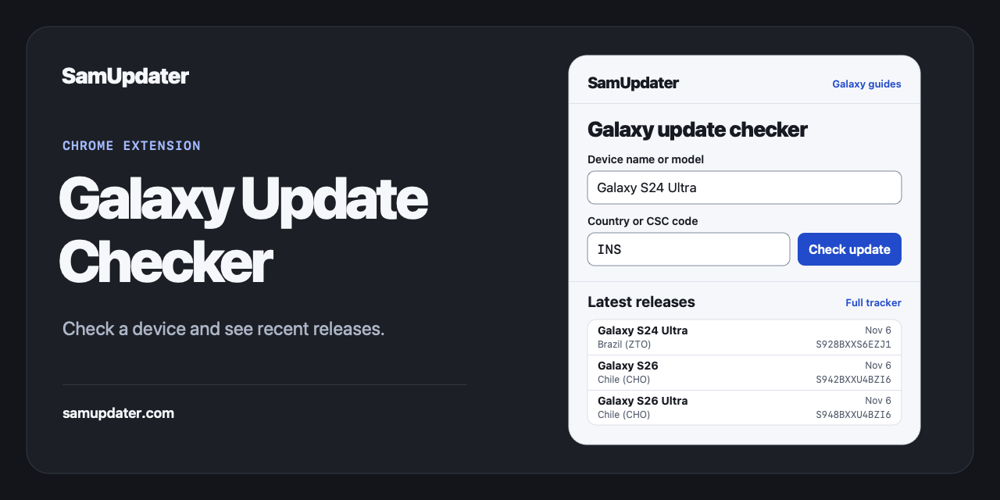

# SamUpdater for Chrome

Open SamUpdater from your Chrome toolbar to see the latest firmware Samsung lists for your Galaxy. Pick your device and country or CSC code to see the build number, release date, security patch, and any One UI and Android versions listed in the release notes.

Below the checker, you can see three recent firmware releases and open Samsung's notes for each model and CSC.

[**Download source ZIP**](https://github.com/Dibyajyotikabi/samupdater-chrome-extension/archive/refs/heads/main.zip) · [SamUpdater website](https://samupdater.com/) · [Galaxy guides](https://samupdater.com/category/how-to/)

## Add it to Chrome

1. Download and extract the ZIP.
2. Open `chrome://extensions` and turn on **Developer mode**.
3. Click **Load unpacked** and choose the folder that contains `manifest.json`.
4. Open **SamUpdater** from Chrome's extensions menu. Try **Galaxy S24 Ultra** with **INS**, then click **Check update**.

If your Galaxy has a carrier variant, enter the model number from **Settings > About phone**. Use our [CSC guide](https://samupdater.com/check-csc-code-samsung-galaxy/) to find the code on your phone.

## Check your build

Open **Samsung notes** in the result to see what changed. To compare the listed build with the one on your phone, open **Settings > About phone > Software information > Build number**. A build can appear in the release notes before your phone offers the download.

If the lookup looks wrong, [tell us](https://samupdater.com/contact/) which model and CSC you entered.

[Privacy policy](PRIVACY.md) · [Web Store submission notes](WEB-STORE.md)
